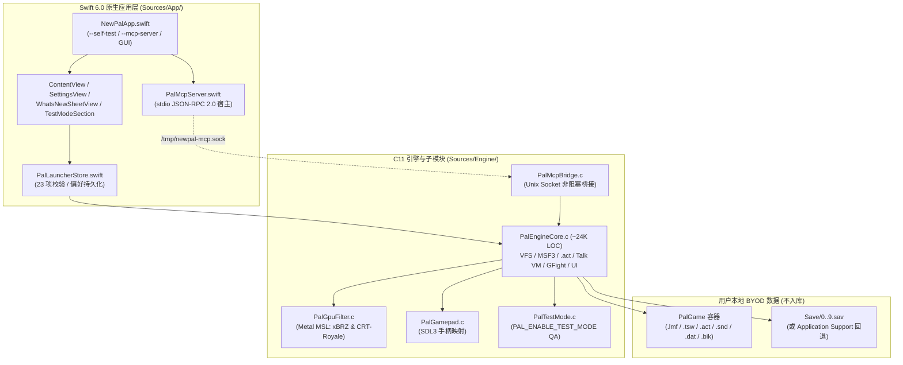

# System architecture

MacNewPal 采用 **SwiftUI 启动器与 MCP 宿主层 + C11 单核引擎与硬件/测试子模块 + 内存级 BYOD VFS** 的三层结构，所有跨层交互通过 `NewPal-Bridging-Header.h` 或本地 Unix Domain Socket 完成。

## 模块职责边界

- **应用层（`Sources/App/`）**：SwiftUI 启动配置、安全作用域目录选择、`Localizable.xcstrings` 中英双语、`WhatsNewSheetView`（仅挂在 Help 菜单），以及独立 `--mcp-server` 进程入口。
- **引擎核心（`Sources/Engine/PalEngineCore.{h,c}`）**：BYOD 签名验证、内存 VFS 解码（LZO1X/ARLE/CP950/FFmpeg）、标题/大地图/战斗/商店/营地状态机、Talk VM 与 GFight 战斗内核。
- **专用子模块**：图形后处理（`PalGpuFilter`）、手柄（`PalGamepad`）、MCP Socket 通信（`PalMcpBridge`）与 QA 调试（`PalTestMode`）保持低耦合接口。
- **离线分析与打包工具（`Tools/`）**：`pal_unpack.py` / `pal_db_unpack.py` / `_lzo_accel.c` 仅供本地只读格式研究；`package_dmg.py` 负责动态库闭环打包与 DMG 生成。

## 关键架构决策

- [[byod-clean-room-vfs]]
- [[c11-core-and-sdl3-metal-pipeline]]
- [[mcp-native-server-and-headless-playtest]]
