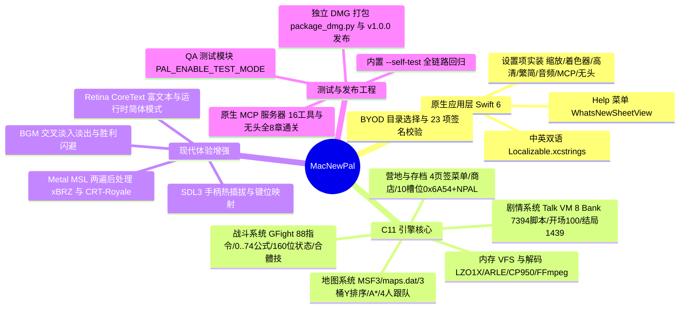

# Feature mindmap

核心专题索引：[[byod-clean-room-vfs]] · [[c11-core-and-sdl3-metal-pipeline]] · [[talk-vm-and-world-state-closure]] · [[combat-and-map-engine-fidelity]] · [[mcp-native-server-and-headless-playtest]] · [[standalone-dmg-and-unsigned-release]]
