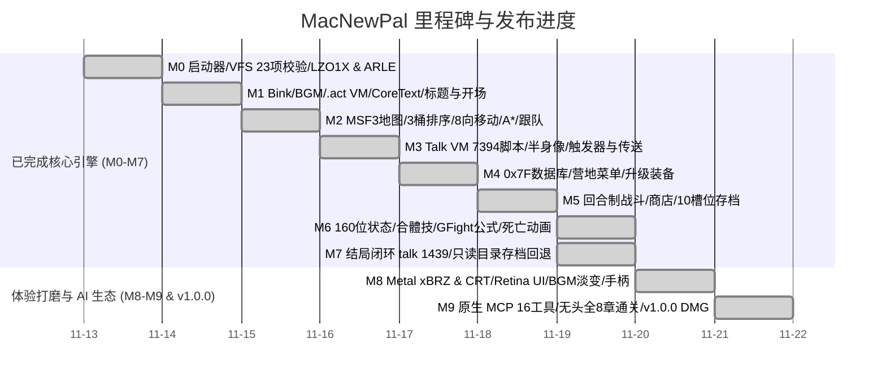

# Roadmap

M0–M9 全部既定里程碑已实现，并已于 `v1.0.0`（commit `46fbdd0`）发布首个独立 DMG 版本。

## 已交付基线（`v1.0.0`）

- **M0–M9 全部完成**：详见 [[standalone-dmg-and-unsigned-release]] 与 [[mcp-native-server-and-headless-playtest]]。
- **GitHub Release**：`v1.0.0` 已发布独立 `NewPal-1.0.0.dmg`（内嵌 SDL3/FFmpeg 依赖、无签名 Gatekeeper 引导文档与中英双语 README）。

## 后续方向（待定 / 需用户确认）

以下方向尚未立项，待后续会话按需确认优先级：
- [ ] **开发者签名与公证（Notarization）**：如未来申请 Apple Developer ID，可替换 ad-hoc 签名并接入 Sparkle 自动更新。
- [ ] **端到端自然剧情深度走查**：借助现有 MCP 16 工具，进一步做不跳剧情的逐章纯手工/AI 走查，排查长流程支线与边角脚本细节。
- [ ] **GitHub Actions CI/CD**：自动化 `xcodegen` + 编译构建与 Release 打包（当前为本机手动执行）。
